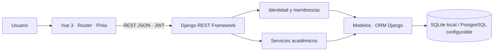

# InscripcionMadeEasy

InscripcionMadeEasy es un sistema multi-tenant para gestionar inscripciones académicas en instituciones educativas. El MVP funcional publicado en `main` organiza solicitudes y genera propuestas de asignación de materias y horarios conforme a prioridades, preferencias y reglas institucionales.

El MVP incluye autenticación, gestión institucional, catálogos, importación CSV, asignación, publicación de resultados y consulta de horarios. Utiliza Django REST Framework, Vue 3 y el ORM Django, con SQLite para demostración local y PostgreSQL configurable.

Desarrollado en la Facultad de Ingeniería de la UNAM, el proyecto evoluciona hacia un SaaS B2B con contratación, pagos y licencias para instituciones. Esos módulos comerciales existen únicamente en V2 local; todavía están en integración y no forman parte de `main`.

## Problema que resuelve

La inscripción exige coordinar cupos, prerrequisitos, materias acreditadas, preferencias y cruces de horario. Resolver estas restricciones de forma manual aumenta la carga administrativa y dificulta explicar por qué una solicitud quedó pendiente. InscripcionMadeEasy centraliza la información y conserva la política aplicada y el resultado de cada propuesta para su revisión antes de publicarla.

## Funcionamiento

1. El usuario se autentica con matrícula y contraseña. Su membresía determina la institución y los permisos disponibles.
2. La administración prepara planes, materias, prerrequisitos y alumnos; importa la oferta de grupos y las solicitudes mediante CSV.
3. La importación se valida antes de confirmar sus cambios en una transacción.
4. El motor procesa solicitudes por prioridad institucional y preferencias, y verifica plan, acreditaciones, prerrequisitos, cupo y conflictos del alumno.
5. La administración revisa la propuesta, sus motivos de rechazo y su exportación CSV; después publica la ejecución seleccionada.
6. Cada alumno consulta su horario publicado. La preselección de materias en el simulador es una ayuda de consulta, no una inscripción persistida.

## Módulos implementados en main

| Módulo | Alcance |
|---|---|
| Identidad y acceso | JWT, renovación de tokens, membresías, roles escolares y selección de institución mediante `X-Tenant-ID` |
| Gestión institucional | Instituciones y aislamiento de consultas y operaciones por membresía |
| Administración académica | Alumnos, planes de estudio, materias, prerrequisitos y estadísticas |
| Importación | CSV de planes, materias, alumnos, grupos y solicitudes; validación y confirmación transaccional |
| Motor de asignación | Algoritmo greedy determinista, política registrada y resultados con información de la decisión |
| Resultados y horarios | Revisión, publicación, exportación CSV y consulta del horario propio |

El motor produce una propuesta completa por institución y mantiene una ejecución publicada. No garantiza un óptimo global ni modela periodos académicos o disponibilidad de aulas y profesores. La demostración SQLite está diseñada para operación local secuencial.

## Arquitectura técnica

Vue 3 implementa la interfaz; Vue Router organiza la navegación, Pinia el estado y Axios las peticiones. Django REST Framework expone la API JSON en `/api/v1/`, aplica autenticación y permisos, y delega reglas a servicios de negocio. Los modelos y el ORM Django gestionan la persistencia.



Este esquema representa la arquitectura publicada. El [diagrama de secuencia de la API](docs/diagramas/diagrama_flujo_api_equipo.pdf) describe las interacciones académicas. La evolución desde Django Templates + Bootstrap se explica en el [ADR 002](docs/adr/002-evolucion-observada.md).

SQLite permite ejecutar la demo sin un servidor de base de datos. PostgreSQL está contemplado mediante el driver, `DATABASE_URL` y Docker Compose; su comportamiento concurrente requiere validación específica antes de producción.

## Modelo SaaS y fase comercial

El modelo B2B consiste en vender acceso al software a instituciones educativas. La capa comercial administra esa relación; no registra colegiaturas ni otros pagos escolares de alumnos.

- **En main:** MVP académico y herramientas de demostración y pruebas.
- **En V2 local (`feature/fase2-ia`):** API de planes, precios, contratos, órdenes, suscripciones, licencias y comprobantes; checkout idempotente, permisos académicos por licencia y paneles Vue de institución y propietario.
- **Pendiente:** completar operaciones administrativas y alinear la experiencia de contratación con los estados y precios del servidor. Algunas pantallas conservan simulaciones ante errores de red.

V2 permite una demostración sin pasarela bancaria y dispone de un adaptador Stripe limitado al modo de pruebas. Sus pruebas automatizadas usan mocks; aún falta validar el recorrido completo contra Stripe sandbox. Los comprobantes son internos, sin validez fiscal.

Las modalidades de cobro, evidencia, endpoints y límites de integración se detallan en [Estado de implementación](docs/ESTADO_IMPLEMENTACION.md).

## Estructura del proyecto

```text
backend/
  config/                   Configuración Django y rutas
  apps/core/                API, modelos, servicios y pruebas académicas
frontend/
  src/                      SPA, módulos, componentes y estado
  documentacion/            ADR inicial
demo_data/                  CSV académicos ficticios
scripts/demo/               Validación de datos e integración HTTP
docs/                       Arquitectura, estado y diagramas
```

En V2 local se agregan `backend/apps/comercial/` y `frontend/src/modules/comercial/`, con áreas de cliente institucional y propietario. La configuración Django y las plantillas conservadas dentro de `frontend/` pertenecen a la interfaz anterior; el cliente activo se ejecuta con Vite.

## Instalación y demostración académica

Requisitos: Python 3.10 o superior con `venv` y `pip`, Node.js 20 compatible con las dependencias actuales y npm. Comandos para Bash, desde la raíz de un checkout de `main`:

```bash
python3 -m venv .venv
source .venv/bin/activate
python -m pip install -r backend/requirements.txt
cd frontend
npm ci
cd ..
```

Crear la base demo una sola vez; el inicializador aplica migraciones e importa datos ficticios:

```bash
python -B backend/manage.py inicializar_demo --settings=config.settings_demo --con-datos
python -B backend/manage.py runserver 127.0.0.1:8000 --settings=config.settings_demo --noreload
```

Si `backend/demo_backend_20261105.sqlite3` ya existe, omitir la inicialización. El comando rechaza archivos existentes. Para una demo adicional, definir `IME_DEMO_DATABASE` con una ruta nueva dentro de `backend/`, de nombre `demo_*.sqlite3`, y conservar esa variable al arrancar el servidor. Las credenciales ficticias se consultan en la salida del inicializador; no se publican contraseñas aquí.

En otra terminal:

```bash
cd frontend
npm run dev -- --host 127.0.0.1
```

Abrir `http://127.0.0.1:5173`. El cliente apunta a `http://127.0.0.1:8000/api/v1`; puede cambiarse mediante `VITE_API_BASE_URL`. La API debe permitir el origen por CORS. Generar y publicar una propuesta como administrador antes de consultar el horario del alumno.

Swagger está disponible en `http://127.0.0.1:8000/docs/` y el esquema en `/api/v1/schema/`. La configuración general usa `DATABASE_URL`; los campos `POSTGRES_*` de [backend/.env.example](backend/.env.example) no seleccionan por sí solos la base de Django. El Compose de la raíz solo inicia PostgreSQL.

### Demostración comercial de V2

Requiere el código local comercial y sus dependencias; no se obtiene al ejecutar los comandos anteriores en `main`. V2 dispone de `backend/demo_pagos.py` para crear una base nueva y de `config.settings_pagos_demo` para ejecutarla con proveedor DEMO. La [guía de estado](docs/ESTADO_IMPLEMENTACION.md#demostración-comercial-local) recoge los comandos verificados por inspección y separa esta demo de la configuración Stripe sandbox.

## Pruebas y validación

Las suites del backend usan SQLite en memoria. Las pruebas Vue usan Vitest. Desde la raíz, con las dependencias instaladas:

```bash
python -B backend/pruebas_aisladas.py
python3 scripts/demo/validate_demo_csv.py
cd frontend
npm test
npm run build
```

Las suites académicas y comerciales ejecutadas en copias temporales aprobaron. Los [resultados y su alcance](docs/ESTADO_IMPLEMENTACION.md#validación-y-preparación-productiva) distinguen main de V2 y las pruebas simuladas de las validaciones externas pendientes. No se midió cobertura ni se ejecutó el build durante esta revisión.

La integración HTTP académica está en `scripts/demo/integration_demo.py`; importa, genera y publica resultados, por lo que requiere una base demo dedicada. No se ejecutó como parte de esta revisión.

## Documentación

- [ADR 001 — Stack y arquitectura inicial](frontend/documentacion/001-stack-y-arquitectura.md).
- [ADR 002 — Evolución a API REST y Vue](docs/adr/002-evolucion-observada.md).
- [Estado de implementación y fase comercial](docs/ESTADO_IMPLEMENTACION.md).
- [Diagrama principal de secuencia](docs/diagramas/diagrama_flujo_api_equipo.pdf) y [original](docs/diagramas/diagrama_flujo_api_original.pdf).
- [Contrato de API académica](docs/DEMO_API_CONTRACT.md).
- [Identidad multi-tenant](backend/docs/identidad_multi_tenant.md).

## Integrantes

- Cristian Michael Aguilar Chávez.
- Cecilia Sayuri Hernández Martínez.
- Emilio García Riba.
- Violeta Camacho Ignacio.
